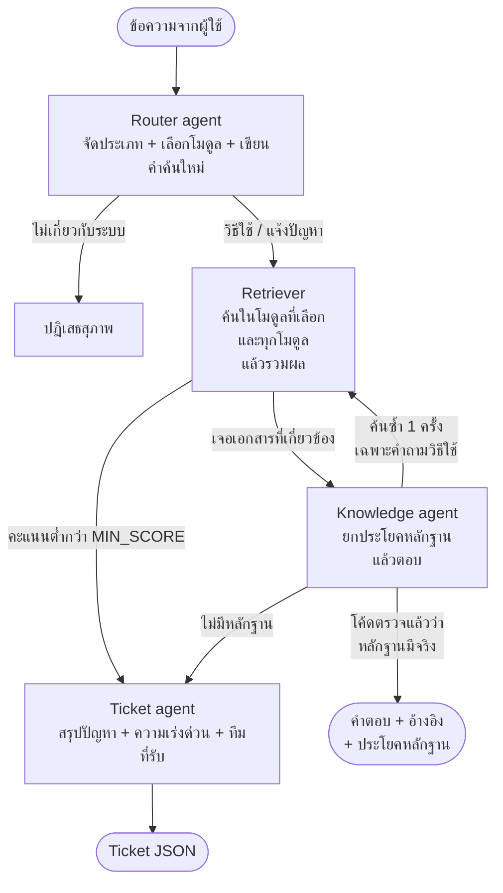

# ERP Helpdesk Agent

ผู้ช่วย Helpdesk สำหรับโปรแกรม ERP ของบริษัทรับเหมาก่อสร้าง ตอบคำถามการใช้งานจากคู่มือพร้อมประโยคหลักฐาน
ถ้าคู่มือไม่มีคำตอบจะไม่เดา แต่เปิด Ticket ที่สรุปปัญหาไว้ให้ทีม Support ทำงานต่อได้ทันที

- ข้อมูลทั้งหมดเป็นข้อมูลจำลองของระบบสมมติชื่อ **SiteERP**
- รันบนเครื่องตัวเองทั้งหมดด้วยโมเดล open-source ผ่าน Ollama ไม่มีค่าใช้จ่าย
- ทดสอบบน Windows, Python 3.12, RTX 5060 (VRAM 8 GB), `qwen2.5:7b` + `bge-m3`

## Workflow



| ขั้น | หน้าที่ | ใครตัดสิน |
|---|---|---|
| Router | แยก `how_to` / `problem` / `out_of_scope`, เลือกโมดูล, เขียนคำค้นใหม่ | LLM (มีกฎ keyword สำรอง) |
| ด่านขอบเขต | ถ้า Router บอกนอกขอบเขต แต่คำถามตรงกับเอกสารในคลัง ให้ถือว่าอยู่ในขอบเขต | โค้ด |
| Retriever | ค้นทั้งในโมดูลที่ Router เลือกและทุกโมดูล เผื่อ Router เลือกโมดูลผิด | embedding |
| ด่านคะแนน | เอกสารอันดับ 1 ต้องได้คะแนนถึง `MIN_SCORE` | โค้ด |
| ด่านรหัส error | รหัส error ที่ไม่มีในเอกสารที่ค้นได้ ส่งไป Ticket โดยไม่ถามโมเดล | โค้ด |
| Knowledge | คัดลอกประโยคหลักฐานจากคู่มือ แล้วตอบจากประโยคนั้น | LLM |
| ด่านหลักฐาน | ตรวจว่าประโยคที่ยกมามีอยู่จริงในเอกสาร ถ้าไม่มีจะไม่ใช้คำตอบ | โค้ด |
| ค้นซ้ำ | ถ้ายังตอบไม่ได้และเป็นคำถามวิธีใช้ agent ตัดสินใจเองว่าจะค้นอีกรอบไหม (สูงสุด 1 ครั้ง) | LLM + โค้ดคุมโควตา |
| Ticket | LLM เขียนหัวข้อ สรุป ความเร่งด่วน ส่วนเลข Ticket และทีมที่รับ โค้ดกำหนด | LLM + โค้ด |

หลักที่ใช้: อะไรที่ต้องถูกทุกครั้งให้โค้ดคุม อะไรที่ต้องใช้ความเข้าใจภาษาให้โมเดลทำ

## ผลวัด

รันเมื่อ 12 พ.ย. 2026 ด้วยคำถามทดสอบ 3 ชุด ชุดละ 22 ข้อ (ควรตอบ / ควรเปิด Ticket / ไม่เกี่ยวกับระบบ) ผลดิบอยู่ใน [`results/`](results)

| ชุดคำถาม | ตัดสินใจถูก | ข้อเท็จจริงครบ | ควรเปิด Ticket แต่ไปตอบ |
|---|---|---|---|
| ชุด 1 `questions.jsonl` (ใช้ปรับระบบ) | 21 / 22 | 15 / 16 | 0 |
| ชุด 2 `heldout.jsonl` | 20 / 22 | 14 / 16 | 0 |
| ชุด 3 `final_check.jsonl` | 22 / 22 | 12 / 14 | 0 |

เวลาเฉลี่ยราว 10.6 วินาทีต่อคำถาม (คำถามแรกหลังเปิดเครื่องใช้ 30–45 วินาทีเพราะต้องโหลดโมเดล)

**ข้อจำกัดของตัวเลขนี้**

- ทั้งสามชุดถูกใช้ปรับเกณฑ์หรือเลือกวิธีไปแล้ว จึงไม่มีชุดไหนที่ระบบ "ไม่เคยเห็น" ตัวเลขรวม 63/66 สูงกว่าที่จะได้กับคำถามใหม่จริง
  ค่าที่ใกล้ความจริงกว่าคือผลครั้งแรกที่ชุด 2 และชุด 3 ถูกรัน: 18/22 และ 19/22 (ราว 82–86%)
- "ข้อเท็จจริงครบ" เช็กด้วย keyword จึงพลาดได้ทั้งสองทาง ข้อ `n05` ในชุด 3 ตอบผิดข้อเท็จจริงแต่ keyword ผ่าน ตารางข้างบนนับข้อนี้เป็นไม่ครบแล้ว
- ชุดทดสอบเล็ก และคนเขียนคำถามกับคนทำระบบเป็นคนเดียวกัน

### การทดลอง: วิธีของขั้นตอบ 4 แบบ

ตรึงผลของ Router กับ Retriever ไว้ แล้วเปลี่ยนเฉพาะขั้นตอบ (`tools/experiment.py`) วัดบน 46 ข้อที่ควรตอบ และ 13 ข้อที่ควรเปิด Ticket

| วิธี | ตอบได้ | เนื้อหาครบ | ตอบมั่ว |
|---|---|---|---|
| A กติกาอย่างเดียว ให้โมเดลบอกเองว่ามีหลักฐานไหม | 42 / 46 | 40 / 46 | 0 / 13 |
| B เพิ่มตัวอย่างใน prompt (few-shot) | 44 / 46 | 43 / 46 | 1 / 13 |
| **C ยกประโยคหลักฐาน แล้วโค้ดตรวจ (ที่ใช้อยู่)** | 43 / 46 | 41 / 46 | 0 / 13 |
| D = C + ตัวอย่าง | 46 / 46 | 42 / 46 | 0 / 13 |

- B ได้เต็มในสองชุดแรก (32/32) แต่ตอบมั่ว 1 ข้อเมื่อเจอชุด 3 ที่เขียนขึ้นใหม่
- D ตอบครบทุกข้อ แต่มีข้อที่ยกหลักฐานผิดประโยคแล้วตอบผิดข้อเท็จจริง
- ผลต่างระหว่าง A กับ C เล็กเกินกว่าจะสรุปว่า C แม่นกว่า เหตุผลที่เลือก C คือหลักฐานตรวจได้ด้วยโค้ด

### สิ่งที่ลองแล้วไม่ได้ผล

| สิ่งที่ลอง | ผล | log |
|---|---|---|
| ให้ agent เลือก ตอบ / ค้นซ้ำ / ส่งต่อ ในคำสั่งเดียว | ชุด 2 ตกจาก 19 เหลือ 14 ข้อ: หลายข้อค้างจน timeout และมี 1 ข้อที่ค้นซ้ำแล้วตอบมั่ว | `results/history/both_log_agentic_v1_failed.txt` |
| บอก Router ว่าผู้ใช้ทุกคนเป็นผู้ใช้ระบบ | ไม่ช่วยข้อที่ตั้งใจแก้ | `results/history/both_log_router_prompt_attempt.txt` |
| few-shot ในขั้นตอบ (วิธี B) | ดีในชุดที่ใช้ปรับ แต่ตอบมั่วในชุดใหม่ | `results/history/all3_log_fewshot_version.txt` |

## Data preparation

คู่มือจำลองใน `data/raw` ถูกทำให้เหมือนข้อความที่ดึงจาก PDF ภาษาไทยจริง (`tools/make_mock_raw.py`) แล้วให้ `prep.py` แก้กลับ

| ปัญหา | จำนวนที่แก้ |
|---|---|
| zero-width space ที่มองไม่เห็นแต่ทำให้ค้นคำไม่เจอ | 66 |
| สระอำที่แตกเป็น นิคหิต + สระอา | 18 |
| เลขไทยปนเลขอารบิก | 29 |
| บรรทัดที่ถูกตัดกลางประโยค | 80 |
| หัว/ท้ายกระดาษที่แทรกกลางเนื้อหา | 20 |
| FAQ: ตัดข้อซ้ำและข้อที่คำตอบว่าง | 15 → 13 |

- สระอำที่แตกแก้ด้วย Unicode NFKC ไม่ได้ เพราะ NFKC แปลงไปทางตรงข้าม (ำ → ํ + า)
- การต่อบรรทัดภาษาไทยต้องไม่เติมช่องว่างเมื่อรอยต่อเป็นอักษรไทยทั้งสองฝั่ง
- เพราะมีต้นฉบับสะอาดเก็บไว้ จึงวัดได้ว่าการ clean กู้ข้อความกลับได้ตรง 93% ของบรรทัด (ไม่นับช่องว่าง) หรือ 88% ถ้านับทุกตัวอักษร (`tools/check_clean_fidelity.py`)
- แบ่ง chunk ตามหัวข้อของคู่มือ และเติมหัวเรื่องไว้หน้า chunk ได้ 40 chunks (คู่มือ 27 + FAQ 13)

## โครงสร้างโปรเจกต์

```
data/source/        คู่มือฉบับสะอาด (ต้นฉบับข้อมูลจำลอง)
data/raw/           คู่มือที่มี noise แบบดึงจาก PDF + FAQ export (CSV) ที่ข้อมูลไม่สม่ำเสมอ
data/eval/          ชุดคำถามทดสอบ 3 ชุด พร้อมเฉลย
helpdesk/prep/      data preparation: clean.py, chunk.py, faq.py
helpdesk/agents/    router.py, knowledge.py, ticket.py
helpdesk/graph.py   ต่อ agent เป็น workflow ด้วย LangGraph
helpdesk/index.py   Chroma vector store
helpdesk/llm.py     เรียก Ollama แบบบังคับ JSON schema
prep.py             ขั้นที่ 1: clean → chunk → embed → index พร้อมรายงาน before/after
chat.py             ขั้นที่ 2: คุยกับ agent ในเทอร์มินัล แสดงการตัดสินใจของแต่ละขั้น
eval.py             ขั้นที่ 3: วัดผลด้วยชุดทดสอบ
tools/              check_setup.py, experiment.py, make_mock_raw.py, check_clean_fidelity.py
results/            ผลการรันจริง และ results/history คือ log ของแต่ละรอบที่ปรับระบบ
run_*.bat           สคริปต์รันทั้งชุดบน Windows แล้วเก็บผลลงไฟล์
```

## ติดตั้ง

ต้องใช้ Python 3.10 ขึ้นไป และ [Ollama](https://ollama.com/download) 0.5 ขึ้นไป

```bash
ollama pull qwen2.5:7b      # โมเดลแชต ราว 4.7 GB
ollama pull bge-m3          # embedding ที่รองรับภาษาไทย ราว 1.2 GB

python -m venv .venv
.venv\Scripts\activate             # Linux/macOS: source .venv/bin/activate
pip install -r requirements.txt
```

## วิธีรัน

```bash
python tools/check_setup.py   # เช็กว่า Ollama เปิดอยู่ โมเดลครบ และวัดเวลาตอบ
python prep.py                # เตรียมข้อมูลและสร้าง index
python chat.py --demo         # สถานการณ์สาธิต 4 แบบ
python chat.py                # พิมพ์ถามเอง
python eval.py --sweep        # วัดผลชุด 1 และดูผลของ MIN_SCORE แต่ละค่า
python eval.py --file data/eval/final_check.jsonl
python tools/experiment.py data/eval/questions.jsonl data/eval/heldout.jsonl data/eval/final_check.jsonl
```

ต้องรัน `prep.py` ใหม่ทุกครั้งที่แก้ข้อมูลหรือเปลี่ยนโมเดล embedding
ถ้าภาษาไทยในเทอร์มินัล Windows เพี้ยน ให้ใช้ Windows Terminal และตั้ง `PYTHONUTF8=1`

### ทดสอบโดยไม่ต้องเปิด Ollama

stub mode ใช้ embedding ปลอมกับกฎ keyword แทน LLM ไว้เช็กว่าโค้ดทั้งสายรันได้ ตัวเลขจากโหมดนี้ไม่ใช่ผลของระบบจริง

```bash
# PowerShell
$env:LLM_BACKEND="stub"; python prep.py; python chat.py --demo
```

## ค่าที่ปรับได้ (environment variable)

| ตัวแปร | ค่าเริ่มต้น | ความหมาย |
|---|---|---|
| `LLM_BACKEND` | `ollama` | `ollama` หรือ `stub` |
| `CHAT_MODEL` | `qwen2.5:7b` | โมเดลแชต |
| `EMBED_MODEL` | `bge-m3` | เปลี่ยนแล้วต้องรัน `prep.py` ใหม่ |
| `MIN_SCORE` | `0.55` | คะแนน cosine ขั้นต่ำของเอกสารอันดับ 1 ตั้งจากผล `eval.py --sweep` |
| `SCOPE_RESCUE_SCORE` | `0.55` | คะแนนขั้นต่ำที่ทำให้คำถามที่ Router บอกว่านอกขอบเขตถูกรับกลับมา |
| `MAX_EXTRA_SEARCHES` | `1` | จำนวนครั้งที่ Knowledge agent ค้นซ้ำเองได้ (0 = ปิด) |
| `MAX_OUTPUT_TOKENS` | `500` | เพดานความยาวคำตอบของโมเดลต่อครั้ง กันโมเดลพิมพ์ไม่หยุด |
| `SEED` | `42` | seed ของโมเดลแชต |
| `TOP_K` | `4` | จำนวนเอกสารต่อการค้นหนึ่งครั้ง |

## ข้อจำกัดที่รู้

- ระบบยังระวังเกินไปในบางข้อ เปิด Ticket ทั้งที่คู่มือมีคำตอบ (`q10`, `h11`)
- Router พลาดกับคำถามที่กำกวมว่าเกี่ยวกับระบบหรือไม่ (`h22`)
- ด่านหลักฐานตรวจได้ว่าประโยคมีอยู่จริง แต่ตรวจไม่ได้ว่าเป็นประโยคที่ตอบคำถามถูกข้อ (`n05`)
- เกณฑ์คะแนนทั้งสองตัวตั้งจากคำถามไม่กี่สิบข้อ และช่องว่างระหว่างสองกลุ่มแคบ
- ยังไม่ได้เทียบกับโมเดลแชตหรือ embedding ตัวอื่น
- ไม่มีเรื่องสิทธิ์เข้าถึงข้อมูล หลายผู้ใช้ หรือการเชื่อมกับระบบ Helpdesk จริง

## ที่มาของแนวคิด

- [DoorDash: RAG-based Dasher support](https://careersatdoordash.com/?p=12568) ด่านตรวจคำตอบและการวัดผลด้วยชุดทดสอบ
- [LinkedIn: RAG with Knowledge Graphs for Customer Service QA (SIGIR '24)](https://arxiv.org/html/2404.17723v2) ใช้ ticket เก่าเป็นแหล่งความรู้

## License

[MIT](LICENSE)
