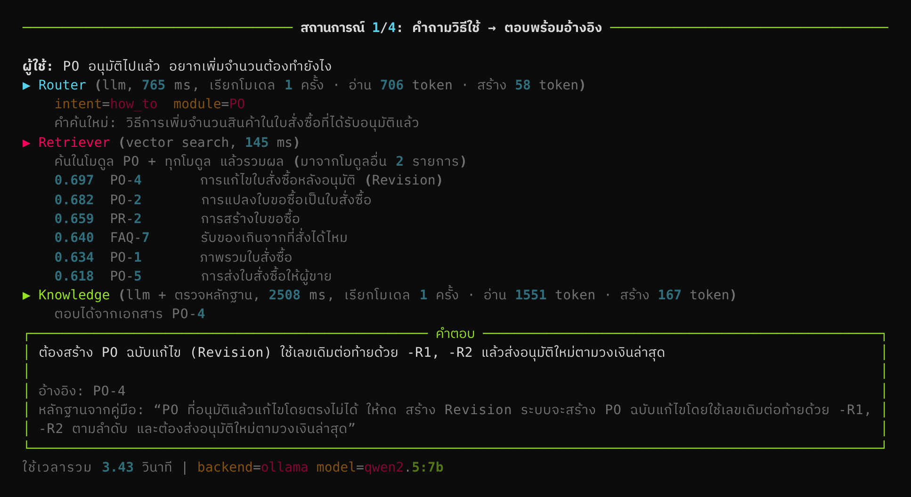
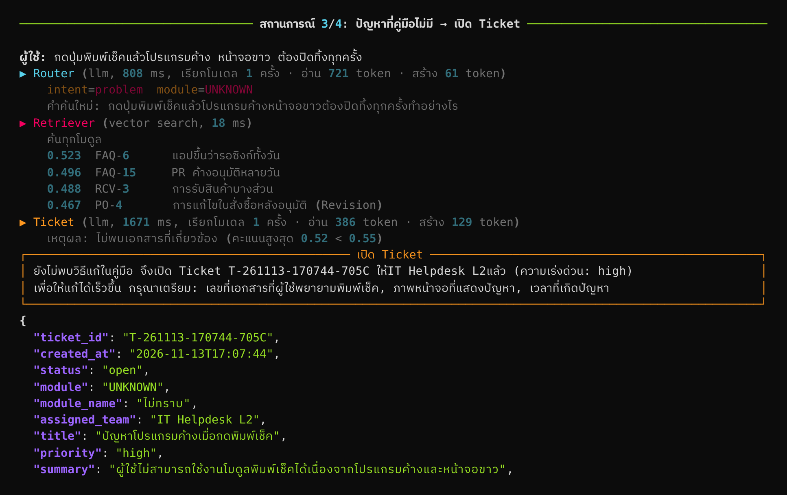
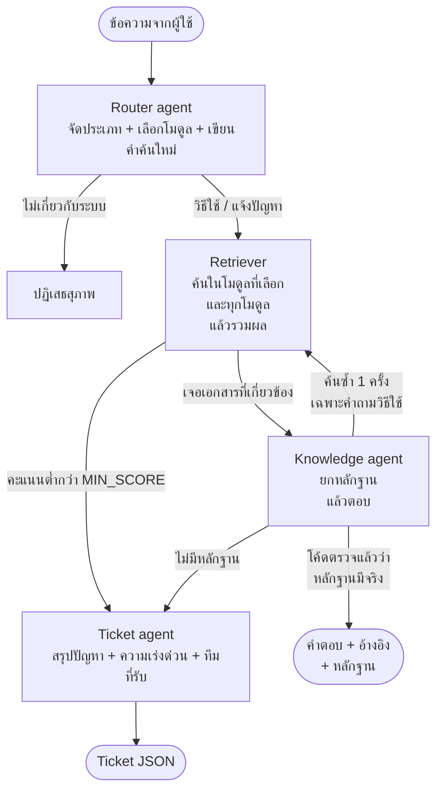
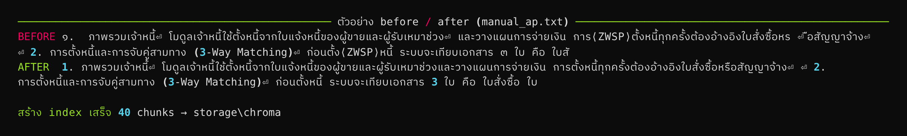

# ERP Helpdesk Agent

[](https://github.com/Sprites-X/erp-helpdesk-agent/actions/workflows/ci.yml)

ผู้ช่วย Helpdesk สำหรับโปรแกรม ERP ของบริษัทรับเหมาก่อสร้าง ตอบคำถามการใช้งานจากคู่มือพร้อมประโยคหลักฐาน
ถ้าคู่มือไม่มีคำตอบจะไม่เดา แต่เปิด Ticket ที่สรุปปัญหาไว้ให้ทีม Support ทำงานต่อได้ทันที

- ข้อมูลทั้งหมดเป็นข้อมูลจำลองของระบบสมมติชื่อ **SiteERP**
- รันบนเครื่องตัวเองทั้งหมดด้วยโมเดล open-source ผ่าน Ollama ไม่มีค่าใช้จ่าย
- ทดสอบบน Windows, Python 3.12, RTX 5060 (VRAM 8 GB), `qwen2.5:7b` + `bge-m3`
- ตอบคำถามละราว 2.8 วินาที (หลังโหลดโมเดลแล้ว)



<details>
<summary>ตัวอย่างกรณีคู่มือไม่มีวิธีแก้ → เปิด Ticket</summary>



</details>

## Workflow



| ขั้น | หน้าที่ | ใครตัดสิน |
|---|---|---|
| Router | แยก `how_to` / `problem` / `out_of_scope`, เลือกโมดูล, เขียนคำค้นใหม่ | LLM (มีกฎ keyword สำรอง) |
| ด่านขอบเขต | ถ้า Router บอกนอกขอบเขต แต่คำถามตรงกับเอกสารในคลัง ให้ถือว่าอยู่ในขอบเขต | โค้ด |
| Retriever | ค้นทั้งในโมดูลที่ Router เลือกและทุกโมดูล เผื่อ Router เลือกโมดูลผิด | embedding |
| ด่านคะแนน | เอกสารอันดับ 1 ต้องได้คะแนนถึง `MIN_SCORE` | โค้ด |
| ด่านรหัส error | รหัส error ที่ไม่มีในเอกสารที่ค้นได้ ส่งไป Ticket โดยไม่ถามโมเดล | โค้ด |
| Knowledge | คัดลอกประโยคหลักฐานจากคู่มือ แล้วตอบจากประโยคนั้น | LLM |
| ด่านหลักฐาน | ตรวจว่าประโยคที่ยกมามีอยู่จริงในเอกสาร ถ้าไม่มีจะไม่ใช้คำตอบ | โค้ด |
| ค้นซ้ำ | ถ้ายังตอบไม่ได้และเป็นคำถามวิธีใช้ agent ตัดสินใจเองว่าจะค้นอีกรอบไหม (สูงสุด 1 ครั้ง) | LLM + โค้ดคุมโควตา |
| Ticket | LLM เขียนหัวข้อ สรุป ความเร่งด่วน ส่วนเลข Ticket และทีมที่รับ โค้ดกำหนด | LLM + โค้ด |

หลักที่ใช้: อะไรที่ต้องถูกทุกครั้งให้โค้ดคุม อะไรที่ต้องใช้ความเข้าใจภาษาให้โมเดลทำ

## ผลวัด

รันเมื่อ 13 พ.ย. 2026 ด้วยค่าตั้งปัจจุบัน บนคำถามทดสอบ 4 ชุด (ควรตอบ / ควรเปิด Ticket / ไม่เกี่ยวกับระบบ)
ผลดิบของชุด 1–3 อยู่ใน [`results/evidence/`](results/evidence) (ไฟล์ที่ลงท้าย `_ev1`) ชุด 4 อยู่ใน [`results/external/`](results/external)

| ชุดคำถาม | ตัดสินใจถูก | ข้อเท็จจริงครบ | ควรเปิด Ticket แต่ไปตอบ |
|---|---|---|---|
| ชุด 1 `questions.jsonl` (ใช้ปรับระบบ) | 20 / 22 | 14 / 16 | 0 |
| ชุด 2 `heldout.jsonl` | 20 / 22 | 14 / 16 | 0 |
| ชุด 3 `final_check.jsonl` | 22 / 22 | 12 / 14 | 0 |
| **ชุด 4 `external_gemini.jsonl` (Gemini เขียน ระบบไม่เคยเห็น)** | **19 / 20** | **6 / 10** | **0** |

เวลาเฉลี่ย 2.8 วินาทีต่อคำถาม (มัธยฐาน 2.7) คำถามแรกหลังเปิดเครื่องช้ากว่านี้เพราะต้องโหลดโมเดลเข้า GPU

**ข้อจำกัดของตัวเลขนี้**

- ชุด 1–3 ผมเขียนเอง และถูกใช้ปรับเกณฑ์หรือเลือกวิธีไปแล้ว ตัวเลขรวม 62/66 จึงสูงกว่าที่จะได้กับคำถามใหม่จริง
  ชุด 4 คือตัวเลขที่ระบบไม่เคยเห็นคำถามมาก่อน แต่มีแค่ 20 ข้อ (ดูหัวข้อถัดไป)
- "ข้อเท็จจริงครบ" เช็กด้วย keyword จึงพลาดได้ทั้งสองทาง ข้อ `n05` ในชุด 3 ตอบผิดข้อเท็จจริงแต่ keyword ผ่าน ตารางข้างบนนับข้อนี้เป็นไม่ครบแล้ว
- รันซ้ำด้วย seed เดิม การตัดสินใจออกมาเหมือนเดิมทุกข้อ แต่ถ้อยคำของคำตอบเปลี่ยนได้เล็กน้อย ตัวเลข "ข้อเท็จจริงครบ" จึงแกว่งได้ราว ±1 ข้อ
- ทุกชุดยังเล็ก และ Gemini เห็นคู่มือชุดเดียวกับที่ระบบใช้ ของจริงต้องวัดด้วยคำถามจาก ticket จริง

### ชุดทดสอบที่ระบบไม่เคยเห็น (เขียนโดย Gemini)

ให้ Gemini เขียนคำถาม 20 ข้อพร้อมเฉลย โดยเห็นแค่คู่มือ 5 ไฟล์กับ FAQ ไม่เห็นโค้ด README หรือชุดทดสอบเดิม
(prompt อยู่ใน [`tools/external_eval_prompt.md`](tools/external_eval_prompt.md)) ตรวจเฉลยด้วย `tools/check_eval_set.py`
แล้วรัน `eval.py` ครั้งเดียว ไม่ได้ปรับระบบหลังเห็นผล

| | ผล |
|---|---|
| ตัดสินใจ ตอบ / Ticket / ปฏิเสธ ถูก | 19 / 20 |
| ควรเปิด Ticket แต่ไปตอบ | 0 |
| ควรตอบได้แต่เปิด Ticket | 0 |
| เอกสารที่ถูกอยู่ในชุดที่ค้นได้ | 10 / 10 |
| ข้อเท็จจริงครบ (เช็กด้วย keyword) | 6 / 10 |
| เวลาเฉลี่ย | 2.89 วินาที |

- ข้อที่ตัดสินใจผิดคือ `g17` (ซื้อของด่วนด้วยเงินสดย่อยต้องขอใบกำกับภาษีเต็มรูปไหม) เป็นคำถามเรื่องภาษี ไม่ใช่การใช้โปรแกรม
  แต่ Router มองว่าอยู่ในขอบเขต จึงเปิด Ticket ที่ไม่จำเป็น เป็นจุดอ่อนเดียวกับ `h22`
- 4 ข้อที่ข้อเท็จจริงไม่ครบ ค้นเจอเอกสารถูกและยกหลักฐานถูกทุกข้อ แต่คำตอบสั้นจนตัดรายละเอียดที่อยู่ในประโยคหลักฐาน
  - `g01` ตอบว่ายกเลิกใบขอซื้อได้ แต่ตัดเงื่อนไขว่าได้เฉพาะใบที่ยังไม่ถูกแปลงเป็นใบสั่งซื้อ
  - `g07` บอกเมนูคืนสินค้า แต่ตัดขั้นตอน "อ้างอิงเลขที่ GR เดิม"
  - `g14` บอกให้กดปิดยอดค้างรับ แต่ไม่บอกว่าต้องเป็นฝ่ายจัดซื้อที่กด
  - `g08` บอกวิธีแก้ถูก (ติดต่อฝ่ายบัญชี) แต่ไม่บอกสาเหตุว่าผู้ขายถูกระงับ
- หน้าจอแชตแสดงประโยคหลักฐานเต็มใต้คำตอบเสมอ ผู้ใช้จึงยังเห็นรายละเอียดที่หายไป แต่ตัวคำตอบควรครบกว่านี้
- ยังไม่ได้แก้ เพราะถ้าแก้ prompt แล้ววัดกับชุดนี้ซ้ำ ชุดนี้จะไม่ใช่ชุดที่ระบบไม่เคยเห็นอีก ต้องมีชุดใหม่ไว้วัด

### เวลา: วัดแยกขั้นแล้วพบว่าเวลาส่วนใหญ่ไม่ได้อยู่ที่โมเดล

`eval.py` บันทึกเวลาของแต่ละขั้น และเวลาที่ Ollama รายงานเอง (prefill = อ่าน prompt, decode = สร้างคำตอบทีละ token)
ผลรอบแรกคือ 10.5 วินาทีต่อคำถาม แต่โมเดลทำงานจริงแค่ราว 2.7 วินาที ส่วน Retriever ที่แค่ทำ embedding คำค้นสั้น ๆ ใช้ไป 3.5 วินาที
ทุกการเรียก Ollama ช้ากว่าที่ Ollama รายงานราว 2 วินาทีเท่ากันหมด และเวลาโหลดโมเดลเป็น 0

สาเหตุ: บน Windows ชื่อ `localhost` ถูกแปลงเป็น IPv6 (`::1`) ก่อน แต่ Ollama รับแค่ IPv4 ทุกการเชื่อมต่อจึงรอราว 2 วินาทีก่อนถอยไปใช้ IPv4
(`tools/probe_ollama.py` วัดเวลาเรียก `/api/version` ซึ่งไม่มีงานของโมเดลเลย: `localhost` 2,034 ms, `127.0.0.1` 0.4 ms)
แก้โดยเปลี่ยนค่าเริ่มต้นเป็น `127.0.0.1`

| ขั้น (เฉลี่ยต่อคำถาม ชุด 1) | ก่อนแก้ | หลังแก้ | เวลาที่โมเดลทำงานจริง |
|---|---|---|---|
| Router | 2.89 s | 0.66 s | 0.62 s |
| Retriever (embedding 2 ครั้ง) | 3.46 s | 0.04 s | – |
| Knowledge | 3.42 s | 1.67 s | 1.63 s |
| Ticket | 0.88 s | 0.40 s | 0.39 s |
| **รวม** | **10.65 s** | **2.77 s** | 2.64 s |

ทั้ง 7B และ 3B ตัดสินใจเหมือนเดิมทุกข้อจาก 66 ข้อ (`results/latency_localhost/` เทียบกับ `results/latency/`)
หลังแก้ เวลา 87% คือ decode ถ้าจะให้เร็วขึ้นอีกต้องลดจำนวน token ที่โมเดลสร้าง หรือแสดงคำตอบแบบ streaming

### เทียบโมเดล: qwen2.5:7b กับ qwen2.5:3b

ใช้ embedding, prompt และเกณฑ์เดียวกัน เปลี่ยนแค่โมเดลแชต (`run_latency.bat`, ผลใน `results/latency/`, สรุปด้วย `python tools/compare_reports.py 7b 3b`)

| | 7B | 3B |
|---|---|---|
| ตัดสินใจถูก (3 ชุด) | 63 / 66 | 40 / 66 |
| ควรตอบได้แต่เปิด Ticket | 2 | 25 |
| **ควรเปิด Ticket แต่ไปตอบ** | **0** | **0** |
| เวลาเฉลี่ยต่อคำถาม | 2.61 s | 1.96 s |
| ความเร็วสร้างคำตอบ | 79 token/s | 148 token/s |
| เรียกโมเดลต่อคำถาม | 2.06 ครั้ง | 3.09 ครั้ง |

- ทั้ง 25 ข้อที่ 3B พลาด ค้นเจอเอกสารที่ถูกแล้ว แต่ 3B ยกหลักฐานที่ผ่านการตรวจไม่ได้ ระบบจึงเปิด Ticket แทน
- โมเดลที่อ่อนกว่าทำให้ระบบ "ส่งต่อคนบ่อยขึ้น" ไม่ใช่ "ตอบผิดมากขึ้น" เพราะด่านที่ตัดสินว่าตอบได้หรือไม่อยู่ในโค้ด
- 3B สร้าง token ได้เร็วเกือบ 2 เท่า แต่ขอค้นซ้ำบ่อยกว่า เวลารวมจึงเร็วขึ้นแค่ราว 25%
- (ตารางนี้วัดก่อนเพิ่มกฎหลักฐานข้อถัดไป จึงเป็น 63/66)

### หลักฐานต้องเป็นเนื้อหา ไม่ใช่หัวเรื่อง

ตอนดูหน้าจอ demo พบว่าโมเดลยกหัวเรื่องที่เติมไว้หน้า chunk เช่น `[ใบสั่งซื้อ (PO) > การแก้ไขใบสั่งซื้อหลังอนุมัติ (Revision)]`
มาเป็น "หลักฐาน" แล้วผ่านการตรวจ เพราะหัวเรื่องอยู่ใน chunk จริง เมื่อบันทึกหลักฐานของทุกข้อพบว่ามีแต่หัวเรื่อง 7 จาก 44 คำตอบ
หนึ่งในนั้น (`n05`) เป็นหัวเรื่องที่โมเดลผสมขึ้นเองจากสองโมดูล แต่ผ่านการตรวจแบบยอมให้คลาดเคลื่อน
จึงให้การตรวจไม่นับหัวเรื่องและบรรทัด "ถาม:" ของ FAQ และบอกกติกานี้ใน prompt (`STRICT_EVIDENCE`, ผลใน `results/evidence/`)

| | แบบเดิม | แบบใหม่ (ใช้อยู่) |
|---|---|---|
| คำตอบที่หลักฐานมีเนื้อหาจริง ไม่ใช่แค่หัวเรื่อง | 37 / 44 | 43 / 43 |
| ตัดสินใจถูก (3 ชุด) | 63 / 66 | 62 / 66 |
| ควรเปิด Ticket แต่ไปตอบ | 0 | 0 |
| เวลาเฉลี่ยต่อคำถาม | 2.61 s | 2.80 s |

แบบใหม่เสีย 2 ข้อ (`q01`, `h02` เปลี่ยนเป็นเปิด Ticket) และได้คืน 1 ข้อ (`h11`) ผลต่าง 1 ข้อจาก 66 เล็กเกินกว่าจะบอกว่าแย่ลงจริง
ที่เลือกแบบใหม่เพราะหลักฐานที่ผู้ใช้เห็นบนจอต้องเป็นประโยคที่ตอบคำถาม ไม่ใช่แค่ชื่อหัวข้อ

### การทดลอง: วิธีของขั้นตอบ 4 แบบ

ตรึงผลของ Router กับ Retriever ไว้ แล้วเปลี่ยนเฉพาะขั้นตอบ (`tools/experiment.py`) วัดบน 46 ข้อที่ควรตอบ และ 13 ข้อที่ควรเปิด Ticket

| วิธี | ตอบได้ | เนื้อหาครบ | ตอบมั่ว |
|---|---|---|---|
| A กติกาอย่างเดียว ให้โมเดลบอกเองว่ามีหลักฐานไหม | 42 / 46 | 40 / 46 | 0 / 13 |
| B เพิ่มตัวอย่างใน prompt (few-shot) | 44 / 46 | 43 / 46 | 1 / 13 |
| **C ยกประโยคหลักฐาน แล้วโค้ดตรวจ (ที่ใช้อยู่)** | 43 / 46 | 41 / 46 | 0 / 13 |
| D = C + ตัวอย่าง | 46 / 46 | 42 / 46 | 0 / 13 |

- B ได้เต็มในสองชุดแรก (32/32) แต่ตอบมั่ว 1 ข้อเมื่อเจอชุด 3 ที่เขียนขึ้นใหม่
- D ตอบครบทุกข้อ แต่มีข้อที่ยกหลักฐานผิดประโยคแล้วตอบผิดข้อเท็จจริง
- ผลต่างระหว่าง A กับ C เล็กเกินกว่าจะสรุปว่า C แม่นกว่า เหตุผลที่เลือก C คือหลักฐานตรวจได้ด้วยโค้ด

### สิ่งที่ลองแล้วไม่ได้ผล

| สิ่งที่ลอง | ผล | log |
|---|---|---|
| ให้ agent เลือก ตอบ / ค้นซ้ำ / ส่งต่อ ในคำสั่งเดียว | ชุด 2 ตกจาก 19 เหลือ 14 ข้อ: หลายข้อค้างจน timeout และมี 1 ข้อที่ค้นซ้ำแล้วตอบมั่ว | `results/history/both_log_agentic_v1_failed.txt` |
| บอก Router ว่าผู้ใช้ทุกคนเป็นผู้ใช้ระบบ | ไม่ช่วยข้อที่ตั้งใจแก้ | `results/history/both_log_router_prompt_attempt.txt` |
| few-shot ในขั้นตอบ (วิธี B) | ดีในชุดที่ใช้ปรับ แต่ตอบมั่วในชุดใหม่ | `results/history/all3_log_fewshot_version.txt` |

## Data preparation

คู่มือจำลองใน `data/raw` ถูกทำให้เหมือนข้อความที่ดึงจาก PDF ภาษาไทยจริง (`tools/make_mock_raw.py`) แล้วให้ `prep.py` แก้กลับ

| ปัญหา | จำนวนที่แก้ |
|---|---|
| zero-width space ที่มองไม่เห็นแต่ทำให้ค้นคำไม่เจอ | 66 |
| สระอำที่แตกเป็น นิคหิต + สระอา | 18 |
| เลขไทยปนเลขอารบิก | 29 |
| บรรทัดที่ถูกตัดกลางประโยค | 80 |
| หัว/ท้ายกระดาษที่แทรกกลางเนื้อหา | 20 |
| FAQ: ตัดข้อซ้ำและข้อที่คำตอบว่าง | 15 → 13 |

- สระอำที่แตกแก้ด้วย Unicode NFKC ไม่ได้ เพราะ NFKC แปลงไปทางตรงข้าม (ำ → ํ + า)
- การต่อบรรทัดภาษาไทยต้องไม่เติมช่องว่างเมื่อรอยต่อเป็นอักษรไทยทั้งสองฝั่ง
- เพราะมีต้นฉบับสะอาดเก็บไว้ จึงวัดได้ว่าการ clean กู้ข้อความกลับได้ตรง 93% ของบรรทัด (ไม่นับช่องว่าง) หรือ 88% ถ้านับทุกตัวอักษร (`tools/check_clean_fidelity.py`)
- แบ่ง chunk ตามหัวข้อของคู่มือ และเติมหัวเรื่องไว้หน้า chunk ได้ 40 chunks (คู่มือ 27 + FAQ 13)



## โครงสร้างโปรเจกต์

```
data/source/        คู่มือฉบับสะอาด (ต้นฉบับข้อมูลจำลอง)
data/raw/           คู่มือที่มี noise แบบดึงจาก PDF + FAQ export (CSV) ที่ข้อมูลไม่สม่ำเสมอ
data/eval/          ชุดคำถามทดสอบ 3 ชุด พร้อมเฉลย
helpdesk/prep/      data preparation: clean.py, chunk.py, faq.py
helpdesk/agents/    router.py, knowledge.py, ticket.py
helpdesk/graph.py   ต่อ agent เป็น workflow ด้วย LangGraph
helpdesk/index.py   Chroma vector store
helpdesk/llm.py     เรียก Ollama แบบบังคับ JSON schema
prep.py             ขั้นที่ 1: clean → chunk → embed → index พร้อมรายงาน before/after
chat.py             ขั้นที่ 2: คุยกับ agent ในเทอร์มินัล แสดงการตัดสินใจของแต่ละขั้น
eval.py             ขั้นที่ 3: วัดผลด้วยชุดทดสอบ
tools/              check_setup.py, experiment.py, make_mock_raw.py, check_clean_fidelity.py,
                    check_eval_set.py (ตรวจเฉลยของชุดคำถาม), external_eval_prompt.md
tests/              unit test (pytest) ใช้โมเดลปลอม ไม่ต้องมี GPU
docs/               ภาพหน้าจอจากการรันจริง
.github/workflows/  CI: lint + test + smoke test ใน stub mode ทุกครั้งที่ push
results/            ผลการรันจริง และ results/history คือ log ของแต่ละรอบที่ปรับระบบ
run_*.bat           สคริปต์รันทั้งชุดบน Windows แล้วเก็บผลลงไฟล์
```

## ติดตั้ง

ต้องใช้ Python 3.10 ขึ้นไป และ [Ollama](https://ollama.com/download) 0.5 ขึ้นไป

```bash
ollama pull qwen2.5:7b      # โมเดลแชต ราว 4.7 GB
ollama pull bge-m3          # embedding ที่รองรับภาษาไทย ราว 1.2 GB
ollama pull qwen2.5:3b      # ไม่จำเป็น ใช้เทียบโมเดลใน run_latency.bat

python -m venv .venv
.venv\Scripts\activate             # Linux/macOS: source .venv/bin/activate
pip install -r requirements.txt
pip install -r requirements-dev.txt   # ถ้าจะรัน test
```

## วิธีรัน

```bash
python tools/check_setup.py   # เช็กว่า Ollama เปิดอยู่ โมเดลครบ และวัดเวลาตอบ
python prep.py                # เตรียมข้อมูลและสร้าง index
python chat.py --demo         # สถานการณ์สาธิต 4 แบบ
python chat.py                # พิมพ์ถามเอง
python eval.py --sweep        # วัดผลชุด 1 และดูผลของ MIN_SCORE แต่ละค่า
python eval.py --file data/eval/final_check.jsonl
python tools/experiment.py data/eval/questions.jsonl data/eval/heldout.jsonl data/eval/final_check.jsonl
python tools/probe_ollama.py  # วัดเวลาที่ใช้แค่ต่อถึง Ollama
python tools/compare_reports.py 7b 3b   # เทียบผลของ eval.py --tag 7b กับ --tag 3b
```

บน Windows มีสคริปต์รันทั้งชุดแล้วเก็บ log: `run_test.bat` (ติดตั้งและทดสอบครั้งแรก), `run_all3.bat` (วัดผล 3 ชุด),
`run_latency.bat` (เทียบ 7B กับ 3B พร้อมเวลาแยกขั้น), `run_evidence_check.bat` (เทียบกฎหลักฐานแบบเดิมกับแบบใหม่)

ต้องรัน `prep.py` ใหม่ทุกครั้งที่แก้ข้อมูลหรือเปลี่ยนโมเดล embedding
ถ้าภาษาไทยในเทอร์มินัล Windows เพี้ยน ให้ใช้ Windows Terminal และตั้ง `PYTHONUTF8=1`

## Unit test และ CI

```bash
python -m pytest              # 76 ข้อ จบในไม่ถึง 2 วินาที ไม่ต้องเปิด Ollama
```

test ส่วนใหญ่ใช้ Ollama ปลอม (`tests/conftest.py`) ที่ตอบตาม JSON schema ของแต่ละ agent
จึงทดสอบโค้ดจริงได้ทั้งเส้น: สร้าง prompt → เรียกโมเดล → parse JSON → ตรวจหลักฐาน → เลือกเส้นทาง
สิ่งที่ test คุมคือกติกาที่บังคับด้วยโค้ด ไม่ใช่ความฉลาดของโมเดล (ส่วนนั้นวัดด้วย `eval.py`)

| กลุ่ม | ตัวอย่างที่เช็ก |
|---|---|
| `test_graph.py` | รหัส error ที่ไม่มีในคู่มือไม่ถึงมือโมเดล, ค้นซ้ำไม่เกิน `MAX_EXTRA_SEARCHES`, การแจ้งปัญหาไม่ค้นซ้ำ, หลักฐานที่แต่งขึ้นไม่ถูกใช้, อ้างอิงมาจากโค้ดไม่ใช่จากโมเดล |
| `test_clean.py` | สระอำ, zero-width, เลขไทย, ต่อบรรทัดไทยไม่เติมช่องว่าง, กู้ต้นฉบับได้อย่างน้อย 90% |
| `test_evidence.py` | ยกมาตรงตัว, ช่องว่างต่างกัน, คัดลอกเพี้ยนเล็กน้อย, สั้นเกิน, แต่งขึ้นเอง |
| `test_index.py` | Chroma จริงบนข้อมูลจริง, กรองโมดูล, ไม่ยอมใช้ index ที่สร้างด้วย embedding คนละแบบ |
| `test_eval_sets.py` | เฉลยทุกชุดอ้างเอกสารที่มีจริง และคำที่ต้องมีในคำตอบอยู่ในเอกสารที่อ้าง |

ลองลบด่านสำคัญออกทีละอัน 7 แบบ (ด่านรหัส error, ด่านหลักฐาน, เพดานการค้นซ้ำ, การห้ามค้นซ้ำกับการแจ้งปัญหา,
การต่อบรรทัดไทย, regex รหัส error, การเติมรหัส error กลับเข้าคำค้น) ทุกแบบมี test พังอย่างน้อย 1 ข้อ

CI บน GitHub รัน pyflakes, pytest และ `prep.py` / `chat.py --demo` / `eval.py` ใน stub mode
(embedding ปลอมกับกฎ keyword แทน LLM) ทุกครั้งที่ push ตัวเลขจาก stub mode ไม่ใช่ผลของระบบจริง

```bash
# PowerShell: รันทั้งสายโดยไม่ต้องเปิด Ollama
$env:LLM_BACKEND="stub"; python prep.py; python chat.py --demo
```

## ค่าที่ปรับได้ (environment variable)

| ตัวแปร | ค่าเริ่มต้น | ความหมาย |
|---|---|---|
| `LLM_BACKEND` | `ollama` | `ollama` หรือ `stub` |
| `OLLAMA_URL` | `http://127.0.0.1:11434` | ใช้ `127.0.0.1` ไม่ใช้ `localhost` (ดูหัวข้อเวลา) |
| `CHAT_MODEL` | `qwen2.5:7b` | โมเดลแชต |
| `EMBED_MODEL` | `bge-m3` | เปลี่ยนแล้วต้องรัน `prep.py` ใหม่ |
| `MIN_SCORE` | `0.55` | คะแนน cosine ขั้นต่ำของเอกสารอันดับ 1 ตั้งจากผล `eval.py --sweep` |
| `SCOPE_RESCUE_SCORE` | `0.55` | คะแนนขั้นต่ำที่ทำให้คำถามที่ Router บอกว่านอกขอบเขตถูกรับกลับมา |
| `MAX_EXTRA_SEARCHES` | `1` | จำนวนครั้งที่ Knowledge agent ค้นซ้ำเองได้ (0 = ปิด) |
| `MAX_OUTPUT_TOKENS` | `500` | เพดานความยาวคำตอบของโมเดลต่อครั้ง กันโมเดลพิมพ์ไม่หยุด |
| `SEED` | `42` | seed ของโมเดลแชต |
| `TOP_K` | `4` | จำนวนเอกสารต่อการค้นหนึ่งครั้ง |
| `STRICT_EVIDENCE` | `1` | `1` = หัวเรื่องของ chunk และบรรทัด "ถาม:" ของ FAQ ใช้เป็นหลักฐานไม่ได้, `0` = แบบเดิม |

## ข้อจำกัดที่รู้

- ระบบยังระวังเกินไปในบางข้อ เปิด Ticket ทั้งที่คู่มือมีคำตอบ (`q01`, `q10`, `h02`)
- Router พลาดกับคำถามที่กำกวมว่าเกี่ยวกับระบบหรือไม่ (`h22`, `g17`)
- คำตอบสั้นจนตัดเงื่อนไขหรือขั้นตอนที่อยู่ในประโยคหลักฐาน (`g01`, `g07`, `g14`)
- ด่านหลักฐานตรวจได้ว่าประโยคมีอยู่จริง แต่ตรวจไม่ได้ว่าเป็นประโยคที่ตอบคำถามถูกข้อ (`n05`)
- เกณฑ์คะแนนทั้งสองตัวตั้งจากคำถามไม่กี่สิบข้อ และช่องว่างระหว่างสองกลุ่มแคบ
- เทียบโมเดลแชตแค่ 2 ขนาดในตระกูลเดียว และยังไม่ได้เทียบ embedding ตัวอื่น
- ไม่มีเรื่องสิทธิ์เข้าถึงข้อมูล หลายผู้ใช้ หรือการเชื่อมกับระบบ Helpdesk จริง

## ที่มาของแนวคิด

- [DoorDash: RAG-based Dasher support](https://careersatdoordash.com/?p=12568) ด่านตรวจคำตอบและการวัดผลด้วยชุดทดสอบ
- [LinkedIn: RAG with Knowledge Graphs for Customer Service QA (SIGIR '24)](https://arxiv.org/html/2404.17723v2) ใช้ ticket เก่าเป็นแหล่งความรู้

## License

[MIT](LICENSE)
