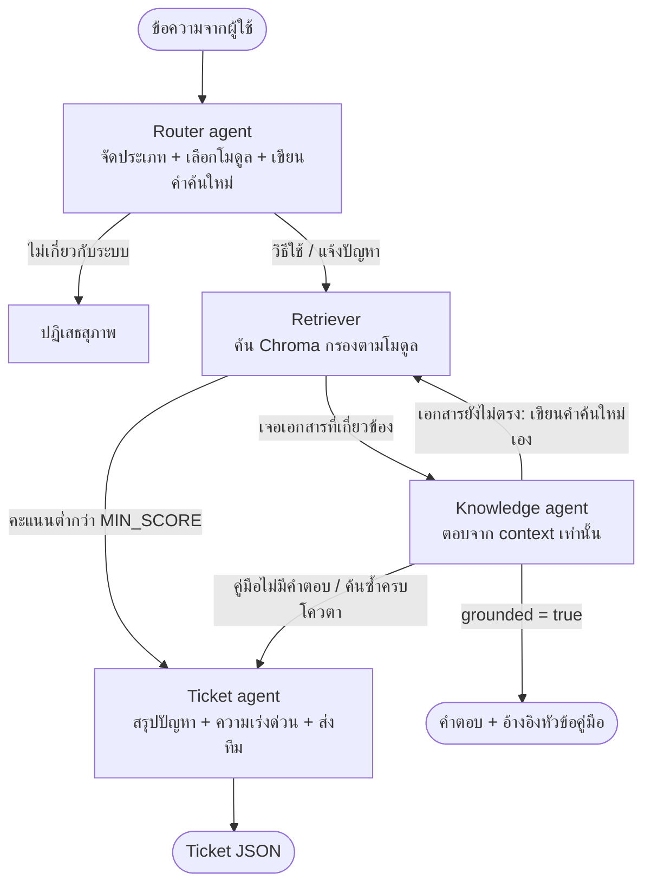

# ERP Helpdesk Agent (mini-demo)

ผู้ช่วย Helpdesk สำหรับโปรแกรม ERP ของบริษัทรับเหมาก่อสร้าง ตอบคำถามการใช้งานจากคู่มือพร้อมอ้างอิงแหล่งที่มา
ถ้าคู่มือไม่มีคำตอบจะ **ไม่เดา** แต่เปิด Ticket ที่สรุปปัญหาไว้ให้ทีม Support ทำงานต่อได้ทันที

หัวข้อ: 1.1 ใช้ AI และ Agentic AI ปรับปรุงงาน **Helpdesk / Knowledge Management**
ข้อมูลทั้งหมดเป็นข้อมูลจำลองของระบบสมมติชื่อ **SiteERP** และทุกอย่างรันบนเครื่องตัวเองด้วยโมเดล open-source ไม่มีค่าใช้จ่าย

## Workflow



| Agent | หน้าที่ | ถ้า LLM ใช้ไม่ได้ |
|---|---|---|
| Router | แยก how_to / problem / out_of_scope, เลือกโมดูล, เขียนคำค้นใหม่ (คงรหัส error ไว้เสมอ) | ใช้กฎ keyword แทน |
| Retriever | ค้น top-k ในโมดูลที่ Router เลือก ถ้าคะแนนต่ำค้นซ้ำทุกโมดูล (เผื่อ Router เดาโมดูลผิด) | – |
| Knowledge | ตอบจากเอกสารที่ค้นได้เท่านั้น โดยต้องยกประโยคหลักฐานจากคู่มือ แล้วโค้ดตรวจว่าประโยคนั้นมีอยู่จริง ถ้าตอบไม่ได้และเป็นคำถามวิธีใช้ จะตัดสินใจเองว่าควรค้นอีกรอบไหมและเขียนคำค้นใหม่เอง โค้ดคุมโควตา (`MAX_EXTRA_SEARCHES`) กันคำค้นซ้ำเดิม และไม่ให้ค้นซ้ำกับการแจ้งปัญหา | ส่งต่อ Ticket |
| Ticket | LLM เขียนหัวข้อ สรุป ความเร่งด่วน ข้อมูลที่ต้องขอเพิ่ม ส่วนเลข Ticket และทีมที่รับผิดชอบโค้ดเป็นคนกำหนด | ใช้กฎแทน |

## โครงสร้างโปรเจกต์

```
data/source/        คู่มือฉบับสะอาด (ต้นฉบับข้อมูลจำลอง)
data/raw/           คู่มือที่ "ดึงจาก PDF" แล้วมี noise + FAQ export (CSV) ที่ข้อมูลไม่สม่ำเสมอ
data/eval/          ชุดคำถามทดสอบ 22 ข้อ พร้อมเฉลย
helpdesk/prep/      data preparation: clean.py, chunk.py, faq.py
helpdesk/agents/    router.py, knowledge.py, ticket.py
helpdesk/graph.py   ต่อ agent เป็น workflow ด้วย LangGraph
helpdesk/index.py   Chroma vector store
prep.py             ขั้นที่ 1: clean → chunk → embed → index พร้อมรายงาน before/after
chat.py             ขั้นที่ 2: คุยกับ agent ในเทอร์มินัล แสดงขั้นตอนของแต่ละ agent
eval.py             ขั้นที่ 3: วัดผลด้วยชุดทดสอบ
tools/              make_mock_raw.py (สร้าง noise), check_clean_fidelity.py (วัดคุณภาพการ clean)
```

## ติดตั้ง

ต้องใช้ Python 3.10 ขึ้นไป และ [Ollama](https://ollama.com/download)

```bash
ollama pull qwen2.5:7b      # โมเดลแชต (~4.7 GB พอดีกับ VRAM 8 GB)
ollama pull bge-m3          # embedding ที่รองรับภาษาไทย

python -m venv .venv
source .venv/bin/activate          # Windows: .venv\Scripts\activate
pip install -r requirements.txt
```

## วิธีรัน

```bash
python tools/check_setup.py # เช็กว่า Ollama เปิดอยู่ โมเดลครบ และใช้ GPU (รันก่อนทุกครั้งที่ตั้งเครื่องใหม่)
python prep.py              # เตรียมข้อมูลและสร้าง index (รันใหม่ทุกครั้งที่แก้ข้อมูลหรือเปลี่ยน embedding model)
python chat.py --demo       # สถานการณ์สาธิต 4 แบบ
python chat.py              # พิมพ์ถามเอง
python eval.py --sweep      # วัดผล + ดูว่าควรตั้ง MIN_SCORE เท่าไหร่
python tools/check_clean_fidelity.py
```

### ทดสอบโดยไม่ต้องเปิด Ollama

ใช้ stub mode เพื่อเช็กว่าโค้ดทั้งสายรันได้ (embedding ปลอม + กฎ keyword แทน LLM)
ตัวเลขจาก stub mode **ไม่ใช่ผลของระบบจริง** อย่าเอาไปใส่สไลด์

```bash
LLM_BACKEND=stub python prep.py && LLM_BACKEND=stub python chat.py --demo
# Windows PowerShell:  $env:LLM_BACKEND="stub"; python prep.py; python chat.py --demo
```

ถ้าภาษาไทยในเทอร์มินัล Windows เพี้ยน ให้ใช้ Windows Terminal หรือตั้ง `PYTHONUTF8=1`

## ค่าที่ปรับได้ (environment variable)

| ตัวแปร | ค่าเริ่มต้น | ความหมาย |
|---|---|---|
| `LLM_BACKEND` | `ollama` | `ollama` หรือ `stub` |
| `CHAT_MODEL` | `qwen2.5:7b` | ลองเทียบกับโมเดลอื่นได้ เช่นโมเดลภาษาไทยที่มีใน Ollama |
| `EMBED_MODEL` | `bge-m3` | เปลี่ยนแล้วต้องรัน `prep.py` ใหม่ |
| `MIN_SCORE` | `0.55` | คะแนนขั้นต่ำของเอกสารอันดับ 1 เป็นค่าประมาณ ให้ปรับตามผล `eval.py --sweep` |
| `MAX_EXTRA_SEARCHES` | `1` | จำนวนครั้งที่ Knowledge agent ขอค้นซ้ำเองได้ (0 = ปิด ใช้เทียบผลก่อน/หลัง) |
| `SEED` | `42` | seed ของโมเดลแชต ให้ผลซ้ำได้ |
| `TOP_K` | `4` | จำนวนเอกสารที่ส่งให้ Knowledge agent |

## สิ่งที่ต้องทำต่อ

- [ ] รัน `prep.py` และ `eval.py --sweep` กับโมเดลจริง แล้วตั้ง `MIN_SCORE` ใหม่
- [ ] ดูข้อที่ eval ผิด แก้ prompt หรือข้อมูล แล้วรันซ้ำ เก็บตัวเลขก่อน/หลังไว้โชว์
- [ ] เทียบโมเดลแชต 2 ตัวด้วย eval ชุดเดียวกัน (ความแม่น + เวลาตอบ)
- [ ] เพิ่มคำถามทดสอบให้หลากหลายขึ้น โดยเฉพาะข้อที่ควรเปิด Ticket
- [ ] อัดวิดีโอ `chat.py --demo` สำรองไว้

## ลำดับการโชว์ (~5 นาที)

1. `python prep.py` → ตาราง before/after ว่าแก้อะไรไปบ้าง (สระอำแตก, zero-width space, หัวกระดาษ, FAQ ซ้ำ/ชื่อโมดูลไม่ตรงกัน)
2. `python chat.py --demo` → 4 เส้นทาง: ตอบพร้อมอ้างอิง, แก้ error จากคู่มือ, เปิด Ticket, ปฏิเสธเรื่องนอกขอบเขต
3. ตารางสรุปจาก `eval.py` (เตรียมผลไว้ล่วงหน้า ไม่ต้องรันสด)

## จุดเด่นที่ควรเล่า

- **ไม่ตอบมั่ว:** มีด่านกันสามชั้น (คะแนน retrieval, รหัส error ที่ไม่มีในคู่มือถูกโค้ดส่งไป Ticket ทันทีโดยไม่ถามโมเดล, Knowledge agent ตรวจ grounded) และวัดผลแยกเป็นตัวชี้วัด "ควรเปิด Ticket แต่ไปตอบ"
- **Data prep ที่เจาะปัญหาภาษาไทย:** สระอำที่แตกตอนดึงจาก PDF ห้ามแก้ด้วย Unicode NFKC เพราะ NFKC แปลงไปทางกลับกัน, การต่อบรรทัดภาษาไทยต้องไม่เติมช่องว่าง, วัดคุณภาพการ clean เทียบต้นฉบับได้เป็นตัวเลข
- **Chunk ตามหัวข้อ + metadata โมดูล:** ค้นแบบกรองโมดูลได้ และมีทางสำรองเมื่อ Router เดาผิด
- **แบ่งงาน LLM กับโค้ดชัด:** อะไรที่ต้องถูก 100% (เลข Ticket, ทีมรับผิดชอบ) ใช้โค้ด ไม่ให้ LLM เดา
- **ทนต่อความผิดพลาด:** LLM ตอบผิดรูปแบบหรือล่ม ระบบถอยไปใช้กฎแทนได้
- **ต่อยอดในงานจริง:** เปลี่ยน `data/raw` เป็นคู่มือจริง, ส่ง Ticket เข้าระบบ Helpdesk ผ่าน API, ใช้ Ticket ที่ปิดแล้วเป็น FAQ ใหม่ให้ระบบเรียนรู้เพิ่มเรื่อย ๆ

## License

[MIT](LICENSE)
